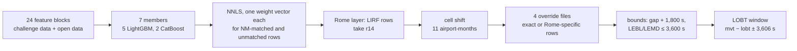

# PRC Data Challenge 2026 — taxi-out prediction, team amazing-marshmallow

Our solution to the [PRC Data Challenge 2026](https://prc-data-challenge-2026.netlify.app/):
predicting the **taxi-out time** of departures at ten large European airports. Our best
leaderboard score is **250.86 s** (v66, 250.8618): the January and July half of our final-phase
submission. The best submission of the leaderboard phase, **v62**, scored 251.25 s (251.2454); our
first model scored 433.80, and a group-mean baseline 604.41. [The final phase](#the-final-phase)
describes what we changed for the organisers' final ranking, on four months of 2026.

This repository holds the code that builds v62 and our final-phase submission, the analyses behind
the claims below, and the full submission history ([`docs/SUBMISSIONS.md`](docs/SUBMISSIONS.md)).
It holds **no data**: the competition files cannot be redistributed, and every open source is
pulled by a script. [`REPRODUCE.md`](REPRODUCE.md) gives the build steps and timings, and a light
version that runs in minutes.

**Contents.**
[The challenge](#the-challenge) ·
[What makes the data hard](#what-makes-the-data-hard) ·
[Open data](#open-data) ·
[The leaderboard-phase submission](#the-leaderboard-phase-submission-v62) ·
[Where the score came from](#where-the-score-came-from) ·
[What did not work](#what-did-not-work) ·
[The final phase](#the-final-phase) ·
[Learnings](#learnings) ·
[Where each number comes from](#where-each-number-comes-from) ·
[Credits](#credits) ·
[Licence](#licence)

## The challenge

- **Task.** For every departure, predict taxi-out: the seconds from leaving the stand (off-block)
  to takeoff. The airports are EDDF, EDDM, EGLL, EHAM, LEBL, LEMD, LFPG, LIRF, LSZH and LTFM.
- **Data.** All of 2025 is for training: 4.17 M movements, of which 2.09 M are departures. They
  come from airport operator records (the label) joined to EUROCONTROL Network Manager flight
  records. The scored set is January and July 2026: 344,841 departures, together with that period's
  arrivals.
- **Metric.** RMSE over all 344,841 departures. There is no public/private split.
- **Rules.** Five submissions a day; teams are ranked on their best. External data is allowed if
  it is openly accessible, documented and openly licensed. The leaderboard closed on 11 October
  2026.
- **Final phase.** One submission predicting the 670,790 departures of January, February, June and
  July 2026, ranked on January + July, on February + June and on all four months. The deadline is
  14 October 2026, 10:00 UTC.

## What makes the data hard

The scripts named in brackets are in [`scripts/analysis/`](scripts/analysis); the table
[at the end](#where-each-number-comes-from) maps each number to its script.

1. **The label is a record, not a measurement.** Taxi-out is `takeoff − block_time`, and in the
   2026 set only `block_time` (and so the label) is hidden, and only on departures. Everything else
   is there: takeoff time, runway, stand, schedule, four other off-block estimates, the flight
   record, and every arrival (`a005`). `block_time` is written by an airport system, and it is
   often a copy of a timestamp we do hold. On about 39% of 2025 departures the label equals
   `takeoff − aobt_3` to within two minutes (`a060`). Where the copied stamp can be identified, the
   label is exact rather than estimated.
2. **A heavy tail of record defects, and RMSE weights it heavily.** Against a constant
   prediction, 0.2% of 2025 departures (labels above 1 h) carry half the squared error. The 34
   labels above 12 h carry 28%, and the 15 above 24 h 20%. These are isolated rows, not bad days:
   with them removed, only 1 of the 30 days that contained one is still unusual. 97.5% of labels
   above 4 h sit on rows with no Network Manager flight match, against a base rate of 1.1% (`a014`).
   Many are plain clerical errors: 14 of the 34 are exactly one day too long (`a008`).
3. **Rome (LIRF) is its own problem.** It has 7.7% of departures but 31 of the 34 labels above
   12 h (`a008`). Its NM-unmatched departures average 6,534 s, against 1,145 s for matched ones
   (`a009`).
   Its cross-validation gains mostly failed to reach the leaderboard (see
   [Learnings](#learnings)), so it gets a separate layer.
4. **Part of the most-used off-block estimate is fabricated.** Where EUROCONTROL never observed the
   off-block, `aobt_3` is takeoff minus a default taxi time. That leaves spikes at 12, 20 and 25
   minutes: about 12% of departures by excess mass, and at LTFM 63% of rows fall in a default band
   (`a001`). Used raw, `aobt_3` scores better than `eobt_1`. Once each is calibrated, `eobt_1` wins,
   344.7 against 351.7 (`a012`).
5. **Providers cut the tail differently.** At LEBL and LEMD no departure or arrival label exceeds
   about 3,600 s (`r03_label_ceilings`).
6. **Exact bounds are hidden in the data.** On every one of the 2,062,577 departures of 2025 that
   have a LOBT, `|block_time − lobt| ≤ 3,606 s`, at every airport (`a112`). The takeoff−schedule
   gap plus 1,800 s is an upper bound on the label: of the ~2.07 M departures of 2025 with a
   positive gap, 88 violate it (`v05_gap_bound`).
7. **2026 is not 2025.** July is the widest month and February has the most long taxis (`a003`).
   EUROCONTROL's published mean taxi-out for EHAM in January rose by 179 s from 2025 to 2026
   (`a119`). adsb.lol's receiver coverage changed too: at EGLL, 21% / 8% of departures had a trace
   in January / July 2025, against 60% / 98% in 2026 (`a115`). A model that learned 2025's trace
   timing over-predicts 2026's.

## Open data

| source | what we took | how it enters | status |
|---|---|---|---|
| [IEM ASOS/METAR](https://mesonet.agron.iastate.edu/request/download.phtml) (Iowa Environmental Mesonet) | METARs for the ten ICAOs, mid-Dec 2024 to Jul 2026: temperature, dew point, humidity, wind, gust, visibility, weather codes | `weather`: the last observation before takeoff, plus de-icing memory (hours at or below 0 °C in the last 24 h, sub-zero streaks) | **used**; dropping the block cost +1.40 trimmed CV |
| [X-Plane Scenery Gateway](https://gateway.x-plane.com/) | each airport's recommended scenery pack: stand positions (apt.dat row 1300) and runway thresholds (row 100) | `stand_geometry`: distance from stand to departure threshold | **used**; it also covers stands never seen in training |
| [OpenStreetMap](https://www.openstreetmap.org/) via Overpass | `aeroway=parking_position` / `gate` names and positions | `stand_geometry`, filling the Gateway's gaps (LTFM 0 → 99%, EDDM 70 → 99%) | **used** |
| [adsb.lol](https://www.adsb.lol/) `globe_history` | 485 days of traces (2025; Jan, Feb, Jun and Jul 2026), cut to each airport's box, on the ground or below 3,000 ft | `adsb`: each departure's own ground segment and takeoff. `adsb_calib`: the same, relative to its airport-month's receiver behaviour | **used**; the largest late gain (v47, −12.59 board) |
| [EUROCONTROL](https://ansperformance.eu/csv/) daily series (ATFM slot adherence, all and ATC pre-departure delay) | per airport and day, 2025 and 2026 | `eurocontrol_daily` | **used** (with two other blocks, v46 −2.43) |
| EUROCONTROL monthly taxi-out indicator (`taxi_out_additional_time`) | per airport-month: flights, valid flights, reference and additional minutes | the cell shift: 11 airport-months moved halfway to the published level, net of the offset the 2025 labels measure (`a120`) | **used** (v56 −0.37) |
| [OPDI](https://www.opdi.aero/) v002 flight lists (EUROCONTROL PRC + OpenSky Network) | monthly flight lists: aircraft, callsign, first and last seen | `opdi`: the same aircraft's ground time since its previous leg; Rome only, through `lg01` | **used** (v58 −0.18) |
| EUROCONTROL APT-DLY and `ert_dly_ansp` (delay by cause) | per airport-day / per ANSP-day delay by cause | — | **tested, rejected**: no signal in the members' residuals, and a day-level correction made both folds worse (`a118`) |
| OpenSky REST `/flights` | 85k departures at LIRF and LFPG | — | **tested, rejected**: `firstSeen` is wheels-off, so it repeats the takeoff time |
| ERA5, KNMI, DWD, MeteoSwiss, Météo-France; holiday calendars; OpenFlights airlines | — | — | **considered, not tested** (two other teams found holiday features slightly harmful) |
| OPDI flight events | — | — | **considered**: pushback events exist in volume only at two airports that adsb.lol already covers |
| OpenSky Trino | — | — | **not allowed** (organiser ruling) |

Statements we owe the reader:

- **The EUROCONTROL files aggregate what is being predicted.** The monthly taxi-out indicator is
  built from the same airport-operator data as the labels, so its 2026 rows aggregate the withheld
  targets themselves. The day-level pre-departure-delay series aggregate off-block times,
  including those of the day being predicted. We first excluded EUROCONTROL's 2026 tables for this
  reason. We used them once the organisers stated that any openly available dataset is eligible,
  whatever the timing of its information, and confirmed that the monthly indicator may be used.
- **The task is post-operational**, as the organisers framed it. Several features use hindsight
  within the day or month: same-day EUROCONTROL aggregates, whole-day runway statistics, the
  departure's own ADS-B trace, month-level trace statistics, and the 2026 monthly means. Only
  `weather` is strictly backward-looking.
- **Licences and attribution:**
  - adsb.lol: ODbL 1.0, "Contains information from adsb.lol".
  - OpenStreetMap: © OpenStreetMap contributors, ODbL.
  - EUROCONTROL: "Source: EUROCONTROL Performance Review Unit". Some of its files carry a
    non-commercial clause.
  - OPDI: CC BY 4.0, per the organisers, as recorded in team kind-mango's notes.
  - X-Plane Scenery Gateway packs: GNU GPL v2 or later, per each pack's README.
  - IEM: its disclaimer puts the data in the public domain.

  We redistribute none of it.

## The leaderboard-phase submission (v62)



**Members.** Each is cross-validated on two folds, January and July 2025, each trained on the
other eleven months. The weights are the NNLS weights v62 fitted on the members' out-of-fold
predictions for non-Rome rows.

| member | model | what is distinctive | CV trimmed, without Rome (Jan / Jul) | weight, matched / unmatched |
|---|---|---|---:|---:|
| `t05_huber_alpha[alpha=600]` | LightGBM | Huber loss, δ = 600 s; 12 blocks | 227.60 (212.89 / 238.86) | 0.017 / 0 |
| `f25_queue2` | LightGBM | 12 blocks + `queue2` (departures ahead of this one at its estimated off-block) | 226.81 (210.67 / 239.10) | 0 / 0.001 |
| `q04_c12_min_leaf30` | LightGBM | 14 blocks incl. `modes5` and `arrival_regime`; labels capped at 3 h | 219.00 (204.66 / 229.98) | 0 / 0.012 |
| `ab07_ab02_adsb_calib` | LightGBM | q04 + `context_window`¹, `gate_retention`¹, `eurocontrol_daily`¹, `adsb`¹, `adsb_calib` | 200.66 (186.96 / 211.13) | 0.225 / 0 |
| `rb01_lirf_route_ab02` | LightGBM | ab07 without `adsb_calib`, routed: one fit for Rome and one for the rest | 200.63 (186.71 / 211.25) | 0.286 / 0.296 |
| `cb03_k20_combo_adsb` | CatBoost | depth 10, 1,024 borders; 17 blocks incl. `modes6` and `adsb`¹ | 200.47 (187.30 / 210.55) | 0.181 / 0.672 |
| `cb04_cb03_adsb_calib` | CatBoost | cb03 + `adsb_calib` | 200.35 (186.76 / 210.73) | 0.293 / 0.068 |

The heart of most members is the `modes` family. These blocks estimate which timestamp
`block_time` copied, if any: a cell-rate table (`modes`), a cross-fitted six-way classifier
(`modes5`), and its two-stage version (`modes6`). They are target-dependent, so they are
recomputed inside every fold.

**Layers after the stack:**

| layer | rows | what | on the board when added |
|---|---:|---|---:|
| Rome layer (`r14`) | 26,899 LIRF | two exact rules, plus a LightGBM routed on the NM-match flag | v30 −0.88 |
| cell shift | 196,151 | 11 airport-months moved by −40.9 … +10.7 s towards EUROCONTROL's published level³ (`a120`) | v56 −0.37 |
| Rome matched-row blend | 26,515 | NNLS of r14 (0.895) and ab07 (0.129) on matched LIRF rows (`a111`) | v42 −0.36 |
| `pop27_gap` | 27 | NM-unmatched LIRF rows that took off more than 20,000 s after schedule: predict the gap itself (`a050`) | v16 + v18 −101.80 |
| `onerow_aobt` | 1 | the matched row whose `takeoff − aobt_3` exceeds 12 h: predict that difference (`a060`) | v24 −25.68 |
| `lirf_um_lg01` | 356 | Rome's other NM-unmatched rows take `lg01`, a gate-delay model: taxi = (takeoff − schedule) − predicted gate delay²; it uses OPDI ground time (`a124`, `a125`) | v58 −0.18 |
| bounds | — | prediction ≤ schedule gap + 1,800 s; LEBL/LEMD ≤ 3,600 s | v25, with the label caps −3.65 |
| LOBT window¹ | 43 rows moved when added | each prediction projected onto `mvt − lobt ± 3,606 s` | v44 −0.77 |

Ideas taken from others. The code is ours throughout; see [Credits](#credits).
¹ team outgoing-boat ·
² team likable-eagle ·
³ suggested by an AI agent that reviewed our notes; see [Credits](#credits).
The rest is our own: the other three overrides, the Rome rules, the modes family, the bounds and
the stacking, though the per-group weights take an idea from a Kaggle solution.

## Where the score came from

From v1's 604.41 to v62's 251.25, 42 submissions each set a new best. Each one's gain is
attributed to the change it made ([full history](docs/SUBMISSIONS.md)):

| theme | board seconds | versions |
|---|---:|---|
| the first gradient-boosted model (deep LightGBM, 511 bins) | −170.61 | v3 |
| Rome's 27 huge-gap NM-unmatched rows predicted from their schedule gap (after removing our own 20,000 s upload clip) | −101.80 | v16, v18 |
| one Rome row predicted at its `takeoff − aobt_3` of about a day | −25.68 | v24 |
| ADS-B members | −14.81 | v47, v51, v53, v62 |
| stacking: ExtraTrees, then five members, then NNLS, then weight groups | −7.54 | v10, v11, v26, v27, v37 |
| a separate weight vector for NM-unmatched rows | −6.07 | v41, v50, v54 |
| a hedge on Rome's unmatched rows, added and later removed | −4.21 | v19, v32 |
| label-capped members + admissible bounds | −3.65 | v25 |
| per-airport LightGBM | −3.42 | v5 |
| the `modes` family | −2.99 | v9, v31, v35, v39 |
| congestion, queue and schedule features | −2.93 | v7, v28 |
| outgoing-boat's context blocks | −2.43 | v46 |
| the Rome model layer (r14, the matched-row blend, lg01) | −1.79 | v30, v42, v48, v52, v58 |
| capacity and hyperparameter variants | −1.66 | v29, v33, v43, v45 |
| stand geometry | −1.13 | v23 |
| weather | −0.94 | v15 |
| LOBT window | −0.77 | v44 |
| cell shift | −0.37 | v56 |
| a 300 s prediction floor | −0.31 | v8 |
| rb01 replacing its unrouted twin | −0.05 | v57 |
| **total** | **−353.16** | |

The NM-match flag itself is in the baseline. The same group-mean model without it scored 24.81
worse (v2).

**How we used the leaderboard.** Every submission is scored on all 344,841 rows. So the score
difference between two submissions that differ on a known set of rows is a known function of
those rows' labels. We used this knowingly, a few times:

- v12 and v13 added 2,000 s to Rome's 383 NM-unmatched rows, and then to January's 107 only, to
  measure their mean residual. v14, a similar shift on 69 rows, was rejected by the daily limit.
- v16 and v17 shipped two value sets for the 27 huge-gap rows on the same base. Their scores imply
  the rows' label sum, 97.5% of their gap sum. v18 then shipped the pure gap, which v62 and the
  final submission still use.
- v24 shipped one row at its data-derived `takeoff − aobt_3` (86,340 s). The score change implies
  that row's label, 86,400 s. v62 and the final submission still ship 86,340.
- v38 applied only half of v37's change: the new weight vector for the 5,283 NM-unmatched rows,
  with v35's weights everywhere else. Because the two row sets are disjoint, the pair of scores
  splits v37's gain exactly: 94% of it came from those 1.5% of rows, where cross-validation had
  predicted a small loss.

Apart from that one shipped row, we never changed rows one at a time. A proposed bisection over the
long-label tail (about 13 submissions) was never run. After v40 we stopped setting the NM-unmatched
rows' level from board results.

## What did not work

| idea | result |
|---|---|
| more capacity: LightGBM at 2,047 bins | the best CV we had (390.59) but +6.66 on the board (v6). It had memorised Rome's 2025 defects |
| a hedge on the 27 huge-gap rows (0.74 × the value + 0.26 × 1,500 s) | +8.27 (v17) |
| scaling predictions above 2,400 s by 1.025; lowering NM-unmatched predictions by 2.3% | +0.06 (v36), +0.21 (v40) |
| a depth-12 CatBoost | +0.11 (v34) |
| ADS-B columns restricted to receiver-independent movement | +1.84 (v49) |
| a member trained on `y − clip(takeoff − aobt_3)`: the best single CV member, and it earned a stack seat cross-fold | +0.09 (v59) |
| a flight-plan residual block | +0.06 (v60); its 2026 mean sits 46 s above 2025's |
| refitting the Rome matched-row blend over more members | +0.12 (v55) |
| EUROCONTROL delay by cause; OpenSky flights | see [Open data](#open-data) |
| precipitation parsed from METAR weather codes; runway-aligned wind | flat in CV; +1.08 in CV |
| a second-stage model on the stack's residuals | no gain in CV |
| XGBoost; an MLP; a linear-tree LightGBM | XGBoost earned no stack weight. The other two carried weight in earlier stacks but none among v62's 20 candidates |

## The final phase

After the leaderboard closed, the organisers added a final phase: one submission predicting
`final_ranking.parquet`, the 670,790 departures of January, February, June and July 2026. This
repository builds it with `TAXIOUT_PHASE=final` ([`REPRODUCE.md`](REPRODUCE.md#the-final-phase)).

**What changed in the data.** The final file holds every leaderboard departure again, plus 325,949
from February and June. The organisers moved every takeoff time, and every arrival's in-block time,
by an integer number of seconds in [−12, 12], independently per row; nothing else changed
(`a126`). Our exact bounds widen by that much: the LOBT window to ±3,618 s, the gap bound to
+1,812 s, the LEBL/LEMD ceilings to 3,624 s.

**How we judged changes.** Cross-validation holds out January + July 2025 and February + June
2025, each trained on the other ten months. `a129` scores the stack per month with its weights
fitted on the other pair. A change was kept only if the stack improved in at least 3 of the 4
months and by at least 0.3 s over the four (trimmed RMSE without Rome), a rule fixed before
running. Placebo members, the same configs plus three columns of noise (the `placebo` block), set
the scale: they moved a member by up to 0.9 s in one month, and the stack by 0.01 s.

| step | what changed | stack CV, four months (`a129`) | board, Jan/Jul half |
|---|---|---:|---:|
| F0 | v62's seven members refitted on the final file; weights, Rome blend and cell shift fitted for the four months | 198.09 | v63: 251.85 |
| F1 | the `snow` block on the five LightGBM members | 197.76 | v64: 251.82 |
| F1u | the NM-unmatched rule below | 196.05¹ | — |
| F2a | cb04 at 4,500 iterations | 195.59 | v65: **251.11** |
| F2b | cb03 at 4,500 iterations | 195.21 | v66: **250.86** |
| **final** | F2b, submitted on 10 October as `amazing-marshmallow_final.parquet` | 195.21 | its Jan/Jul half is v66 |

¹ In `a129` the January + July vector is fitted on February + June alone, which overstates this
rule. Holding out one month at a time puts it at −1.13 over the four months (`a137`).

**v63 against v62.** The refitted members differ from v62's by about 31 s RMS on the leaderboard
rows, and the takeoff noise explains 2–4% of that (`a132`). The rest follows from inputs that the
final file changes: stand taxi-in statistics now include its February and June arrivals, and two
blocks renumber their categories (`a133`). 0.1% of ADS-B matches changed (`a134`). The four-month
weights also put the January and July NM-unmatched rows 110 s above v62's (`a135`), which is what
the unmatched rule below addresses.

**February and snow.** February is the hardest month. Istanbul carries half of its trimmed squared
error, and two snow days there carry 30%: on 19 and 23 February 2025 its departures averaged 46 and
49 minutes and were under-predicted by about 930 s (`a127`, `a128`). The `snow` block counts METAR
snow reports in the 3 to 48 hours before takeoff, heavy snow and freezing rain, the day's total and
the hours since the last report. It cut the LightGBM members' February error by 1.6 to 8.4 s and
barely moved the CatBoost members' (cb04 +0.19, cb03 −0.59, with its NM-unmatched rows worse). In
the stack the five LightGBM swaps passed the gate, February −0.91, and adding the two CatBoost
swaps made it worse than F0 (+0.22). Summer thunderstorms, checked the same way, left too little
to model (`a131`).

**The NM-unmatched rows.** v62's stack gives these 1% of rows their own NNLS vector. Fitted on the
four months it is cb03 × 1.151, pulled up by February's two storm days at Istanbul, which hold 66%
of February's unmatched squared error (`a137`). Holding out one month at a time, a vector fitted
without February is better on January, June and July by 1.32, 1.24 and 1.84 s, and no rule that
excludes February predicts February. So the unmatched vector for January, June and July is fitted
without February 2025 (it sums to 1.037), and February's unmatched rows keep the four-month vector
(`build_stack.py --unmatched-without-month 02`). On the 2026 rows this lowers the unmatched
predictions by 168 s in January and by 106 s in June and July.

**Tuning.** The CatBoost members were short of iterations. At 4,500 instead of 3,000, cb04 and cb03
each improved every month by 1.2 to 1.6 s as members, and each passed the stack gate in turn (−0.46,
then −0.38). Nothing else passed: five
variants of ab07 with the snow block (feature fraction, categorical smoothing, bagging, extra
trees, Huber loss), a lower learning rate on ab07, and three variants of cb04: `l2_leaf_reg` 10,
`random_strength` 3, and learning rate 0.03 with 5,000 iterations. The last came closest. As a
member it cut February by 4.0 s and the NM-unmatched rows by 15 s, but in the stack it improved
only two months, both in place of cb04 and beside its 4,500-iteration version. Seed replicates were
not run: a near-replicate of ab07 placed beside it moved
the stack by 0.013 s.

## Learnings

- **Find out how the label was written before you model it.** After the first LightGBM, 28 Rome
  records were worth −127.5 board seconds; all other work together was worth −55.1. In each of
  those 28, the label could be read, approximately, from other fields of the same record.
  "Information beats modelling" holds here, but the most valuable information was about the
  recording process, not about aircraft.
- **With RMSE, take the error budget first.** A tenth of a percent of rows can outweigh a month of
  feature work. Two LFPG rows once carried 38% of the stack's non-Rome squared error. We selected
  models on a trimmed metric (labels ≤ 12 h) and used the untrimmed one only to predict the board.
- **Cross-validation is a ruler with coarse ticks.**
  - Large changes reached the board at roughly 0.75–1.3 times their CV size.
  - Changes under about 0.2 s predicted neither the size nor the sign of the board change.
  - Rome's CV gains arrived at 3–4%.
  - On NM-unmatched rows, CV pointed the wrong way four times.
  - Some gains (receiver drift) existed only in 2026.

  Writing down how to read each experiment before running it kept us from rereading results to
  fit.
- **Bounds that hold in the data are nearly free.** The LOBT window held on every 2025 departure
  that had a LOBT, and the gap bound on all but 88. Projecting a prediction onto an interval that
  contains the truth can only reduce that row's error. Look for such bounds early.
- **Most of our wrong numbers came from correct code run on the wrong object.**
  - A refit path ignored the label cap.
  - A build was missing its override files; we caught it because its maximum prediction was
    impossibly low.
  - A mutable member list had been silently restored to a stale version.

  Version every composition, check the extremes of each build, and join each override back
  before uploading.
- **Check whether a fitted level belongs to one month.** In the final phase, one weight vector for
  the NM-unmatched rows, fitted on four months, was set by two storm days in one of them. Holding
  out one month at a time showed it in minutes. A placebo member, the same model plus noise
  columns, is as cheap, and says how small a gain can be and still be real.
- **Read the other teams' write-ups.** Our largest late gain (ADS-B, −12.59) and two smaller ones
  (the context blocks, the LOBT window) were ideas another team had published.

## Repository layout

```
config/experiments/        v62's nine configs (seven members, the Rome layer r14, the Rome gate-delay model lg01),
                           and the final phase's variants: snow, placebo controls, tuning
config/compositions/       the member lists: v62's and the final submission's
config/cellshift_v54.csv   the 11 airport-month shifts v62 applies
src/taxiout/               io, row spine, feature store (26 blocks), CV, models, post-processing
scripts/                   data pulls, spine and feature builds, CV, refits, the stack, the light tier
scripts/analysis/          the analyses behind this README, and the generators of the four override files
tests/                     pure-logic tests always run; data-dependent ones skip without the data
docs/SUBMISSIONS.md        every submission and its score, as logged at the time
```

## Where each number comes from

Every analysis is a `# %%` cell script. It writes a transcript to `reports/` when run on the
competition data.

| claim | script |
|---|---|
| only `block_time` and the label are hidden in 2026 | `a005_basics.py` |
| the label equals `takeoff − aobt_3` on about 39% of departures; the one-row override | `a060_aobt_identity_extreme.py` |
| 0.2% of rows carry half the squared error; isolated rows, not bad days; 97.5% unmatched above 4 h | `a014_outlier_profile.py` |
| 31 of the 34 labels above 12 h are at Rome; 14 are exactly a day too long | `a008_disruption_events.py` |
| Rome's unmatched rows: 6,534 s against 1,145 s | `a009_flight_match.py` |
| `aobt_3` default bands; calibrated `eobt_1` beats it | `a001_offblock_proxies.py`, `a012_proxy_calibration.py` |
| LEBL/LEMD labels end near 3,600 s | `r03_label_ceilings.py` |
| the LOBT window; the schedule-gap bound | `a112_lobt_window.py`, `v05_gap_bound.py` |
| month effects | `a003_target_outliers.py` |
| EUROCONTROL's published taxi-out against our labels; the cell shift | `a119_published_taxi_out.py`, `a120_cell_shift.py` |
| adsb.lol receiver drift | `a115_adsb_drift_and_error_budget.py` |
| delay by cause tested and rejected | `a118_apt_dly.py` |
| Rome: lg01 against r14, cross-fold; its override | `a124_lirf_gate_delay.py`, `a125_lirf_um_override.py` |
| the 27 huge-gap rows; the Rome matched-row blend | `a050_pop27_values.py`, `a111_rome_matched_blend.py` |
| final phase: the organisers' ±12 s on takeoff times | `a126_final_randomness.py` |
| February's error: Istanbul's snow days | `a127_february_error.py`, `a128_feb_jun_level_and_snow.py` |
| the stack on the final phase's folds; members per month | `a129_stack_cv.py`, `a130_member_months.py` |
| summer thunderstorms | `a131_summer_thunderstorms.py` |
| F0 against v62: refits, feature stores, ADS-B matches | `a132_board_vs_final.py`, `a133_feature_drift_between_phases.py`, `a134_adsb_matches_under_noise.py` |
| the NM-unmatched level per pair and per held-out month | `a135_unmatched_level.py`, `a137_unmatched_month_transfer.py` |
| two builds of the final file compared | `a136_compare_builds.py` |
| board scores and their deltas | [`docs/SUBMISSIONS.md`](docs/SUBMISSIONS.md) |

Cross-validated member scores are from our run log. They are reproduced by `make cv`.

## Credits

- **Team outgoing-boat** published their full solution
  ([EnioAguiar/prc-taxiout-2026](https://github.com/EnioAguiar/prc-taxiout-2026), GPL v3) when they
  withdrew. From it we took:
  - the ADS-B features on every departure, and several of their parameter choices (segment and
    matching tolerances, the 3,000 ft ceiling);
  - the `context_window`, `gate_retention` and `eurocontrol_daily` blocks;
  - the LOBT window;
  - their "transfer gate", a check on how a cross-validation gain splits between body and tail,
    which we ran before shipping a new member;
  - their documentation of adsb.lol's changed coverage.

  We took ideas, measurements and parameter values, not code. Everything was re-implemented and
  re-verified on our data.
- **Team likable-eagle** ([ChandanHegde07/OpenAir](https://github.com/ChandanHegde07/OpenAir)) gave us
  three things for Rome's unmatched rows: the gate-delay form `T = D − G`, with their CatBoost
  settings for G; the OPDI same-aircraft ground time; and, from their leaderboard reversals, the
  practice of choosing a Rome blend weight on one month and scoring it on the other.
- **Team kind-mango**
  ([skylinkapi/prc-data-challenge-2026-kind-mango](https://github.com/skylinkapi/prc-data-challenge-2026-kind-mango))
  recorded the organisers' rulings and OPDI's licence in their notes. Their anchored-target and
  flight-plan-residual members are two ideas we tested and did not keep (v59, v60).
- We also read the public repositories of teams
  [joyous-rainbow](https://github.com/radekacar/joyous-rainbow),
  [quirky-honey](https://github.com/dhsdb010/OPDI) and
  [thoughtful-glove](https://github.com/mqignacio/prc2026_thoughtfulglove). quirky-honey and likable-eagle
  published the LOBT window too, independently of outgoing-boat.
- **Earlier competitions.**
  - The winners of the previous two PRC Data Challenges normalised their targets before modelling
    ([2024](https://github.com/PRC-Data-Challenge-2024/team_likable_jelly),
    [2025](https://github.com/PRC-Data-Challenge-2025/resourceful-quiver)). That is the idea
    behind our offset model.
  - Separate blend weights per group come from the second-place solution of Kaggle's ASHRAE Great
    Energy Predictor III.
- **The challenge Discord**:
  - the wake-pair spacing idea behind `runway_history`;
  - warnings about adsb.lol's coverage;
  - the organisers' rulings: open trajectory data, EUROCONTROL's 2026 files and OPDI allowed,
    OpenSky's Trino not; the task is post-operational.
- **A list of five data suggestions**, written by an AI agent that had read our notes, reached us
  on 7 October. Its first item, checking our 2026 means against EUROCONTROL's published monthly
  taxi-out, became the cell shift. The others were the delay-by-cause files (tested, rejected),
  hourly precipitation from national weather services, adsb.lol joins for unmatched rows, and
  holiday calendars (not tested).
- **Data:** adsb.lol, OpenStreetMap contributors, the X-Plane Scenery Gateway artists, the Iowa
  Environmental Mesonet, EUROCONTROL's Performance Review Unit, and the OPDI project.

### AI assistance

This solution was built with [Claude Code](https://claude.com/claude-code), Anthropic's coding
agent. It wrote most of the code, the analysis scripts and the documents, including this README,
under the direction of the team, which decided what to test and what to submit.

## Licence

The code is released under the [GNU General Public License v3.0](LICENSE). No competition data or
third-party data is included. Each source keeps its own licence (see [Open data](#open-data)).
